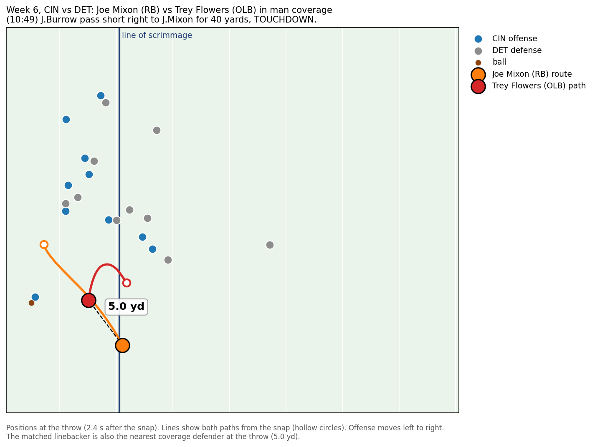

# Mismatch Market: are defenses putting linebackers on the wrong tight ends and running backs?

> Tight ends get 0.4 more yards of space against a linebacker than against a defensive back, and defenses are not steering linebackers away from the players who exploit it.


**What it is.** Mismatch Market grades the defense's man-coverage matchup choices: for each tight end and running back it measures *Respect* (how much less often than normal he draws a linebacker) and *Punishment* (how much extra separation he gets when he does), so an offensive coordinator sees which matchups to attack, a defensive coordinator sees which to stop calling, and a broadcaster gets a one-line graphic.

**Finding.** On man-coverage dropbacks in Weeks 1–8 of 2021, tight ends had 2.26 yards of separation at the throw against a linebacker versus 1.84 against a defensive back, and targets to them were worth +0.36 more EPA (95% interval +0.02 to +0.71), yet how often a player drew a linebacker had almost nothing to do with how much he beat them (r = 0.06 across 67 players, 0.20 without one blocking tight end).

**Who to attack.** Mark Andrews (+0.97 yards over expected), Najee Harris (+1.02) and Hunter Henry (+0.69) kept drawing linebackers at or above the normal rate for their alignment while Kyle Pitts drew one on 2% of his routes, and Miami gave up the most extra space this way (7.9 yards per game, on the most TE/RB man-coverage routes of any defense).

**Method.** Man plays come from PFF's coverage tag; each route runner is matched to one coverage defender by the smallest average distance from snap to throw (Hungarian assignment), separation is the distance to the nearest coverage defender at the throw on every route whether or not he was targeted, and both numbers are compared with the average for the same position and alignment (inline, slot, wide, backfield).

**Assumptions and limits.** Matchups are inferred from tracking rather than charted, so pick plays, switches and zone snaps tagged as man add noise; separation is not the same as being a threat (Marcedes Lewis, a blocking tight end who leaks out late, looks under-respected because defenses leave him alone on purpose); eight weeks gives only 20–85 routes per qualified player; and the hint that defenses adjust over time (r = 0.40 for Weeks 1–4 vs 5–8) flips to −0.16 if the season is split a week earlier, so it is a hint and not a finding.

## Run it

```
python3 mismatch_market.py
```

Needs pandas, numpy, scipy and matplotlib; takes about 10 seconds. It rebuilds `cache/matchups.pkl` from the tracking files if the cache is missing, and reads EPA from `external/nflverse_epa_2021.csv`, which it downloads from nflverse only if that file is missing. Column definitions for the provided data are in [DATA.md](DATA.md).

## Outputs (`outputs/`)

- `1_market.png`: the main chart above, Respect vs Punishment for 67 TEs and RBs.
- `2_defenses.png`: the linebacker tax, extra separation given up per game on linebacker matchups, by defense.
- `3_adjust.png`: did defenses adjust between Weeks 1–4 and Weeks 5–8?
- `4_play.png`: Joe Mixon's 40-yard touchdown against Lions OLB Trey Flowers in man coverage.
- `players.csv`: every player's routes, linebacker rate, normal rate, Respect and Punishment.
- `epa_by_matchup.csv`: EPA per target by matchup. Running backs show no clear difference between linebackers and defensive backs.





Data: NFL Big Data Bowl 2023 files (NFL Next Gen Stats tracking, PFF scouting). EPA: [nflverse](https://github.com/nflverse/nflverse-data) play-by-play, CC BY 4.0, trimmed to this dataset's plays.
