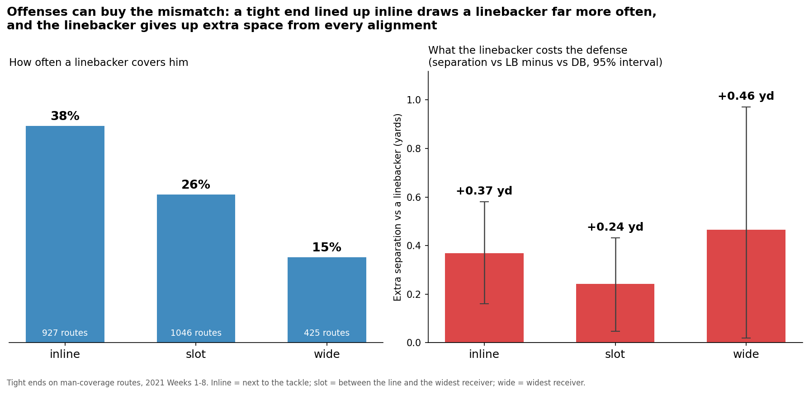
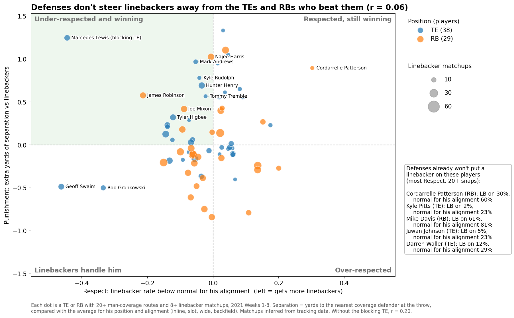
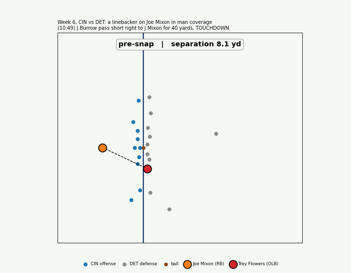
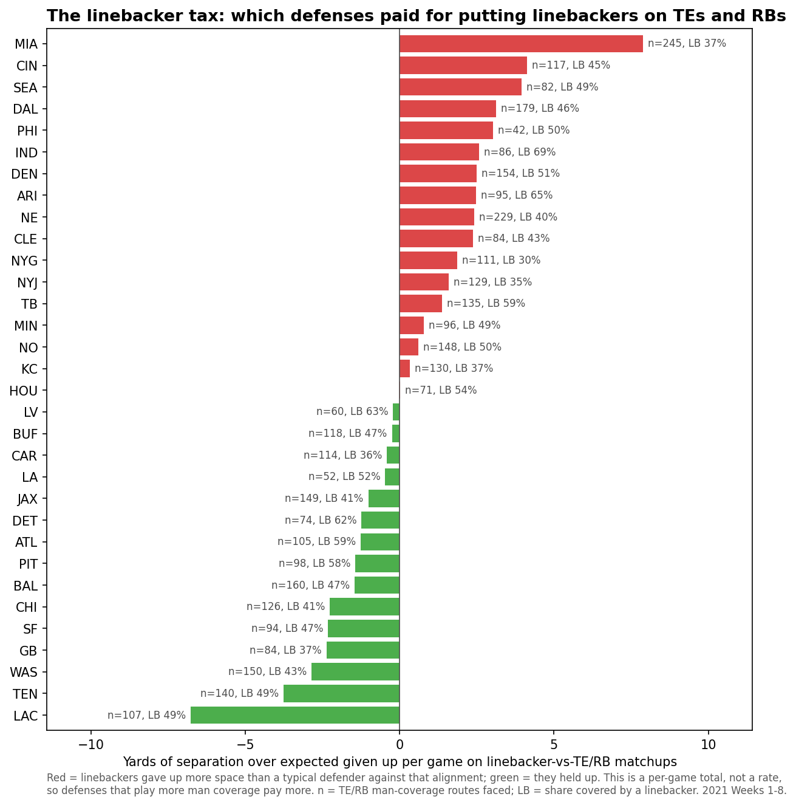
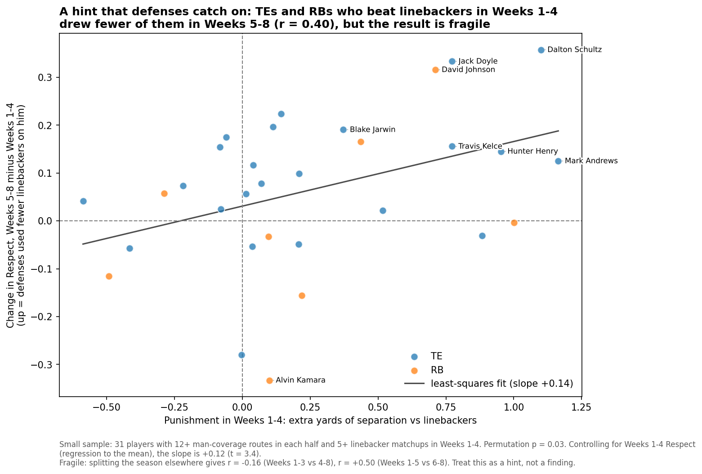

# Mismatch Market: are defenses putting linebackers on the wrong tight ends and running backs?

> A linebacker on a tight end costs the defense 0.4 yards of separation and 0.36 expected points per target. Offenses can buy that matchup by lining the tight end up inline, and defenses are not steering linebackers away from the players who win it.

**[Open the interactive explorer](https://arrxy.github.io/nfl-big-data-bowl-regional-event-data/)**: hover any player for his scouting card, pick a defense to see where it puts linebackers, and play the example snap frame by frame (source: `docs/index.html`).



**What it is.** Mismatch Market grades the defense's man-coverage matchup choices: for each tight end and running back it measures *Respect* (how much less often than normal he draws a linebacker) and *Punishment* (how much extra separation he gets when he does), so an offensive coordinator sees which matchups to hunt, a defensive coordinator sees which to stop calling, and a broadcaster gets a one-line graphic.

**Finding.** On man-coverage dropbacks in Weeks 1–8 of 2021, tight ends got 0.43 more yards of separation at the throw against a linebacker than against a defensive back (95% interval 0.28 to 0.58, and positive from every alignment), targets to them were worth +0.36 more EPA (+0.02 to +0.71), and a tight end lined up inline drew a linebacker on 38% of routes versus 15% split wide, so the offense largely chooses how often it gets the matchup.

**The defense's side.** Respect is a real, repeatable choice (split-half reliability 0.50): defenses put a linebacker on Kyle Pitts on 2% of his routes and Darren Waller on 12%, but there is no sign they steer linebackers away from whoever is currently winning (r = 0.06 across 67 players, 0.20 without one blocking tight end), which leaves Mark Andrews, Najee Harris and Hunter Henry drawing linebackers at or above the normal rate while gaining 0.7 to 1.0 extra yards, and Miami giving up the most extra space this way (7.9 yards per game).

**Method.** Man plays come from PFF's coverage tag; each route runner is matched to one coverage defender by the smallest average distance from snap to throw (Hungarian assignment), separation is the distance to the nearest coverage defender at the throw on every route whether or not he was targeted, and both numbers are compared with the average for the same position and alignment (inline, slot, wide, backfield).

**Assumptions and limits.** Matchups are inferred from tracking rather than charted, so pick plays, switches and zone snaps tagged as man add noise; separation is not the same as being a threat (Marcedes Lewis, a blocking tight end who leaks out late, looks under-respected because defenses leave him alone on purpose); one player's Punishment over eight weeks is noisy (split-half reliability 0.08, 8 to 33 linebacker matchups each), so the named players are candidates and the league-wide numbers are the dependable ones; and the hint that defenses adjust over time (r = 0.40 for Weeks 1–4 vs 5–8) flips to −0.16 if the season is split a week earlier.





## Run it

```
python3 mismatch_market.py
```

Needs pandas, numpy, scipy and matplotlib (with Pillow, for the GIF); takes about 10 seconds. Then `python3 interactive.py` (needs plotly) rebuilds the interactive page at `docs/index.html`. It rebuilds `cache/matchups.pkl` from the tracking files if the cache is missing, and reads EPA from `external/nflverse_epa_2021.csv`, which it downloads from nflverse only if that file is missing. Column definitions for the provided data are in [DATA.md](DATA.md).

## Outputs (`outputs/`)

- `docs/index.html`: the interactive explorer (player scouting cards, defense picker, animated play).
- `5_alignment.png`, `alignment.csv`: tight ends by alignment, how often a linebacker covers him and what it costs (top chart).
- `1_market.png`: Respect vs Punishment for 67 TEs and RBs, with standard-error bars.
- `4_play.gif`, `4_play.png`: Joe Mixon's 40-yard touchdown against Lions OLB Trey Flowers in man coverage.
- `2_defenses.png`: the linebacker tax, extra separation given up per game on linebacker matchups, by defense.
- `3_adjust.png`: did defenses adjust between Weeks 1–4 and Weeks 5–8?
- `players.csv`: every player's routes, linebacker rate, normal rate, Respect, Punishment and its standard error.
- `epa_by_matchup.csv`: EPA per target by matchup. Running backs show no clear difference between linebackers and defensive backs.




Data: NFL Big Data Bowl 2023 files (NFL Next Gen Stats tracking, PFF scouting). EPA: [nflverse](https://github.com/nflverse/nflverse-data) play-by-play, CC BY 4.0, trimmed to this dataset's plays.
